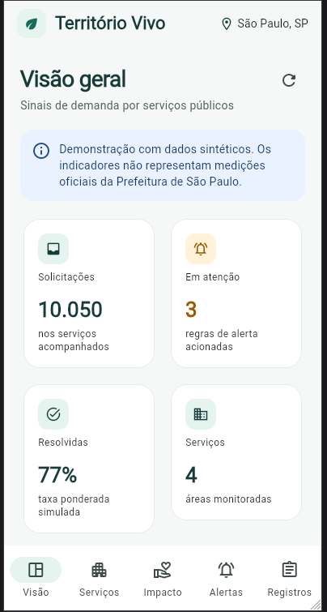
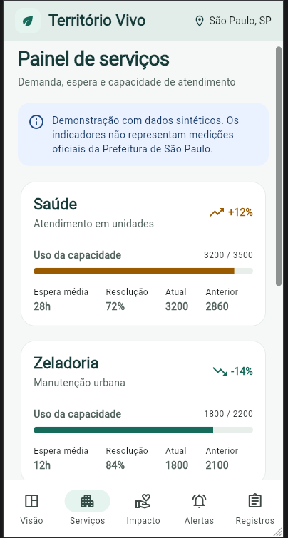
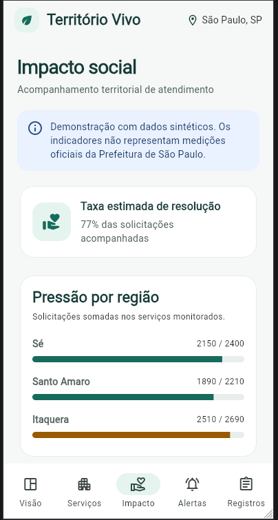
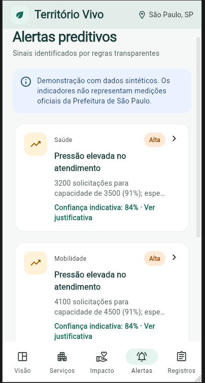
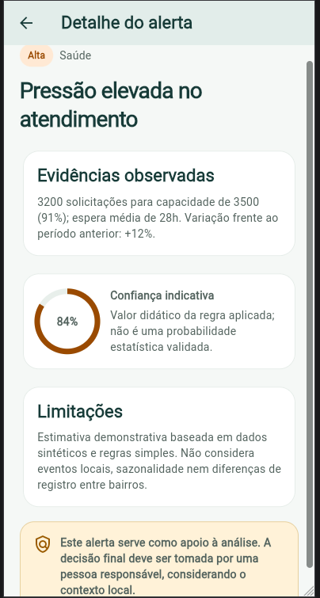
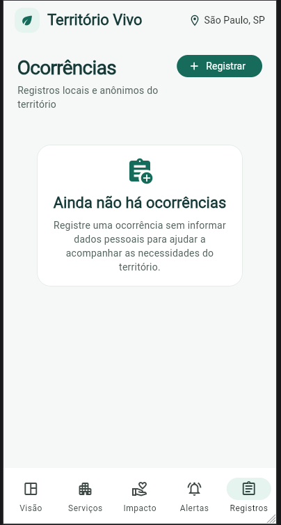
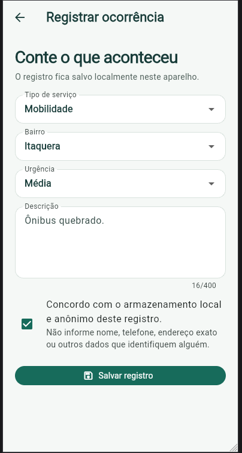

# Território Vivo

**Um painel demonstrativo que ajuda cidadãos e gestores a acompanhar a demanda por serviços públicos em São Paulo.**

> Projeto acadêmico para a Global Solution 2026.2 — CitizenTech.

## Problema e público

A demanda por serviços públicos pode variar entre áreas e regiões, dificultando a identificação de períodos de maior pressão e necessidades de atendimento. O Território Vivo reúne indicadores demonstrativos de saúde, zeladoria, mobilidade e assistência social para que cidadãos e gestores possam explorar tendências, evidências e alertas de forma compreensível.

O protótipo usa somente dados sintéticos. Não representa a operação nem os indicadores oficiais da Prefeitura de São Paulo e não deve ser usado para decisões públicas reais.

## Integrantes

| Nome completo | RM |
|---|---|
| Pedro Lisboa | 565722 |
| Bruna Marques | 565648 |

## Demonstração visual

| Tela | Captura |
|---|---|
| Visão geral |  |
| Painel de serviços |  |
| Impacto social |  |
| Alertas preditivos |  |
| Detalhe do alerta |  |
| Ocorrências |  |
| Formulário de ocorrência |  |

## Funcionalidades

- [x] Navegação nomeada entre painéis, alertas, detalhes e formulário.
- [x] Três dashboards: visão geral, serviços e impacto social.
- [x] Indicadores de demanda, capacidade, espera, resolução e variação.
- [x] Alertas gerados por regras transparentes, com evidência, confiança indicativa e limitações.
- [x] Registro validado de ocorrência e histórico salvo no banco local.
- [x] Tratamento de carregamento, erro e conteúdo vazio.
- [x] Layout responsivo com navegação inferior em telas estreitas e lateral em telas largas.
- [x] O aviso informa que a análise apoia, mas não substitui, a decisão humana.
- [x] Roda sem conexão depois de instalado: os indicadores são fornecidos por um JSON local e ocorrências ficam no dispositivo.
- [x] Tema claro, escuro e de alto contraste, com preferência persistida no dispositivo.
- [x] Notificações locais opcionais para alertas críticos no Android, sem notificações repetidas.

## Dados e alertas

O arquivo `lib/data/sample_data.json` contém dados sintéticos criados para a demonstração. O `MockCityService` simula uma resposta de serviço local, incluindo um pequeno atraso, e converte o JSON em indicadores. Não há integração com uma API municipal ou coleta de dados reais.

As regras atuais geram:

- **Crítico:** demanda igual ou superior à capacidade.
- **Alta:** demanda a partir de 90% da capacidade ou espera média de pelo menos 24 horas.
- **Atenção:** aumento de demanda igual ou superior a 15% sobre o período anterior.

A primeira regra aplicável determina a severidade de cada serviço. A confiança exibida é um valor didático associado à regra, não uma probabilidade calibrada ou validada. Os dados não incluem sazonalidade, eventos locais, subnotificação, diferenças de registro ou contexto operacional. Portanto, alertas e indicadores não são previsões confiáveis para uso fora deste protótipo.

## Privacidade e inclusão

O formulário não solicita nome, contato ou endereço exato. Orienta a pessoa a não inserir dados identificáveis na descrição e exige consentimento para salvar o registro localmente. As ocorrências são armazenadas no SQLite do dispositivo; não são transmitidas a um servidor.

O app usa componentes nativos do Flutter, rótulos e descrições semânticas em indicadores, controles com texto legível e layout adaptável a diferentes larguras. O indicador de benefício social demonstrativo é a taxa ponderada de resolução das solicitações, acompanhada por ressalvas sobre qualidade e cobertura dos dados.

## Tecnologias e decisões técnicas

- **Flutter e Dart:** uma implementação para Android e Web.
- **Provider (`ChangeNotifier`):** gerenciamento de estado simples e compartilhado entre telas.
- **SQLite (`sqflite`):** persistência local das ocorrências no Android.
- **SQLite WASM (`sqflite_common_ffi_web`):** persistência no navegador, armazenada em IndexedDB.
- **JSON local e `MockCityService`:** fonte sintética simulada, sem dependência de rede.
- **SharedPreferences:** persistência das preferências de tema e notificações.
- **Flutter Local Notifications:** notificações locais opcionais no Android.
- **Material 3:** componentes e identidade visual consistentes e adaptáveis.

## Como executar

### Requisitos

- Flutter SDK estável e Dart compatível com `pubspec.yaml`.
- Para Android: Android Studio, Android SDK, ferramentas de linha de comando e emulador ou dispositivo.
- Para Web: navegador moderno. O modo `web-server` pode ser aberto manualmente no navegador.

Confirme o ambiente com:

```bash
flutter doctor -v
```

No Android Studio, instale o Android SDK, Command-line Tools e NDK pelo SDK Manager. Depois aceite as licenças com:

```bash
flutter doctor --android-licenses
```

### Instalação e execução

Na raiz do projeto:

```bash
flutter pub get
dart run sqflite_common_ffi_web:setup
flutter run -d chrome
```

Se o Chrome não estiver configurado como dispositivo Flutter:

```bash
flutter run -d web-server --web-port 7357
```

Abra `http://localhost:7357` no navegador. Para executar no Android, inicie um emulador ou conecte um dispositivo com depuração USB e rode:

```bash
flutter devices
flutter run -d <id-do-dispositivo>
```

Os arquivos `web/sqlite3.wasm` e `web/sqflite_sw.js` são gerados pelo comando `setup` acima e precisam estar presentes também ao compilar/publicar a versão Web.

### Testes e análise

```bash
flutter analyze
flutter test
```

## Vídeo

[Assista à demonstração do Território Vivo no YouTube](https://youtu.be/f3vpSwsq008)

## Licença

Projeto acadêmico desenvolvido para a FIAP — Global Solution 2026.2. Os dados incluídos são sintéticos e destinados exclusivamente à demonstração.
